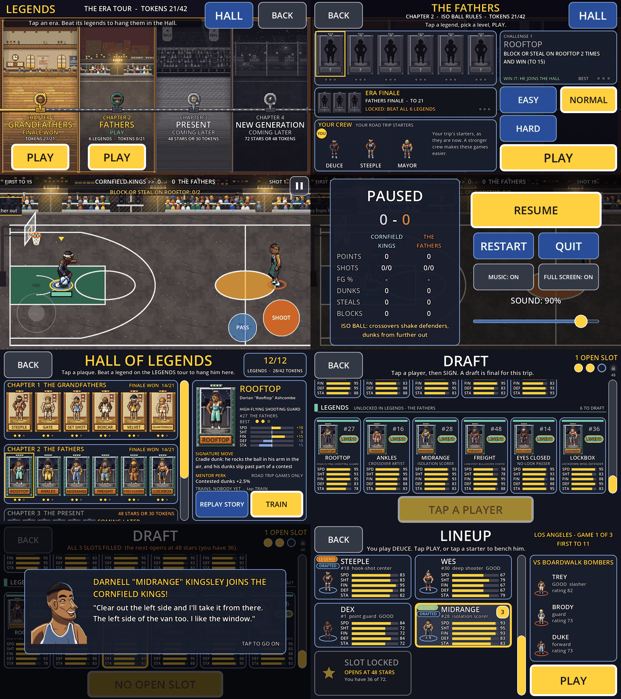

# P10-30: final Phase 10 QA (Legends Chapter 2, "the Fathers")

- **Build tested:** `498ad3e` (branch `ccr-f5c087b2-3ojk5f`: all of Phase 10, through P10-29's docs and P10-20's
  music, Headspin as `legends_fathers.ogg`). Godot 4.3 stable, Linux. Version 1.0.0.
- **Isolation:** every native run used its own copy of the project (from `git archive`, `config/name="Hoops QA P1030
  <run>"`) and its own fresh `XDG_DATA_HOME`. The pairs that must share files (`--triptest-data` + `--load`, the two
  `--trip-stop-after` + `--trip-resume` / `--legends-test` pairs) shared one name and one data folder, and nothing else
  did. At most 2 Godot processes ran at once (a 2-slot queue). The screenshot runs saved to their own folders
  (`--shots-dir`). The web build came from a separate clean copy with the real project name. Nothing in `scripts/` was
  changed. The copies were deleted at the end.
- **Import:** `godot --headless --import` exit 0, no script errors or warnings.
- **Runs:** 77 Godot runs (plus the web export) and 19 Playwright sessions on the web build. Every run reached its end line. The only
  non-zero exit came from my harness: the plain `--anim-test` was OOM-killed (exit 137) while `--anim-test
  --anim-fake-v2` ran next to it (Phase 9 hit the same thing). Rerun alone, it passed.

**Verdict: release-ready, with one bug to fix if the lead wants it in this phase.** Every test mode passed, the
Fathers music plays, and the web build works by touch through LEGENDS, a Chapter 2 view, a Fathers challenge (start,
pause, QUIT), the Hall with a Father, a mentor assignment and a Fathers draft. I found one new bug, **P10-B7**
(medium-low, cosmetic): a strip of the twist banner stays stuck at the left edge after the banner slides out. It is
older than Phase 10 (P6 code), but every Legends game has a twist, the owner plays on the web, and there the strip is
easy to see. It is a one-line fix.

*Web build, touch, 1280x720. Row 1: the timeline with Chapter 2 open (Chapter 1 done, 21 tokens, 36 stars), and the
Fathers chapter view with the trip crew (DEUCE, STEEPLE, MAYOR). Row 2: Rooftop's challenge 25 s in, with the stuck
banner strip "...her out" at the left under the goal line (P10-B7), and the pause panel with the ISO BALL line. Row 3:
the Hall on Rooftop (P10-B5 and B6 fixes hold), and the draft's FATHERS row. Row 4: Midrange's joining line, and the
lineup with Midrange starting after Steeple was benched (a second legend was refused first).*

## 1. Trip tests (`--trip-test --target 3`)

| Run | Result | Games | Screens | Record | Star checks | Draft | Replay (other level) | Errors |
|---|---|---|---|---|---|---|---|---|
| `--difficulty easy` | TRIP END, complete | 41 | 154 | 24-16 | 41/41 ok; 24/24 paid, every game >= 1, total 24 | `ht_boss` | memphis:1 at HARD, lost, trip unchanged | 0 |
| `--difficulty normal` | TRIP END | 37 | 140 | 24-12 | ok; 24/24 paid, >= 2, total 48 | `ht_boss` | memphis:1 at HARD, lost, unchanged | 0 |
| `--difficulty hard` | TRIP END | 54 | 180 | 24-29 | ok; 24/24 paid, 3 each, total 72 | `ht_boss` | memphis:1 at EASY, lost, unchanged | 0 |
| `--difficulty legend --stars 72` | TRIP END | 66 | 198 | 24-41 | ok; 24/24 paid, 3 each, total 72 | `ht_boss` (4 slots) | memphis:1 at EASY, won, unchanged | 0 |
| easy `--legends-unlock-all --stars 24` | TRIP END | 34 | 137 | 24-9 | ok; 24/24 paid | `lg_rooftop` (FATHERS row), `lg_steeple` (GRANDFATHERS row) | memphis:1 at HARD, won | 0 |
| normal, same flags | TRIP END | 43 | 154 | 24-18 | ok | the same | memphis:1 at HARD, won | 0 |
| hard, same flags | TRIP END | 73 | 223 | 24-48 | ok | the same | memphis:1 at EASY, lost | 0 |
| legend `--legends-unlock-all --stars 72` | TRIP END | 61 | 193 | 24-36 | ok; total 72 | the same (4 slots) | memphis:1 at EASY, lost | 0 |
| normal `--trip-stop-after chicago` | TRIP STOP, saved at memphis game 1, map | 11 | | 6-5 | ok | | | 0 |
| `--trip-resume` (new process, same name and data) | TRIP END | 36 | 119 | 24-22 overall | ok; 24/24 paid, total 48 | `ht_boss` | memphis:1 at HARD, lost, unchanged | 0 |
| hard `--trip-stop-after chicago` (for the trip-crew Legends run, section 3) | TRIP STOP | 13 | | 6-7 | ok | | | 0 |

Every run exited 0. Every run from a fresh title visited the LOCKER and back. The 4 legend runs (P10-24, two eras):
"TRIP legend eras at the end | rows offered ["grand", "fathers"] | drafted ["fathers", "grand"] | one legend tried
["grand", "fathers"] | legend + boss fathers | ok". A second legend starter was refused ("ONLY ONE LEGEND CAN START.
Bench STEEPLE first."). A game started Rooftop + `ht_boss` with `ud_deuce` as YOU, and the driver never made a legend
YOU. "total 24 (real 49)" in the `--stars 24` runs is expected, because `--stars` overrides the total shown. These are
CPU vs CPU games to 3, so the records are noise. Still, the losses rise from Easy to LEGEND, as in Phase 9.

## 2. Self tests

| Test | Result |
|---|---|
| `--legendtest` | LEGENDTEST OK (data: legends 12, 2 of 4 chapters built, max tokens 42; save OK; progress OK). **The P10-23..28 NOTE about the missing `legends_fathers.ogg` is gone** |
| `--backtest` | BACKTEST OK, exit 0. Includes the P10-25 Chapter 2 steps: the Fathers view to the timeline, the Hall on `lg_rooftop` back to the chapter view, a Fathers challenge (`lg:lg_rooftop`) pauses (tree paused), and QUIT lands on chapter `fathers` |
| `--titletest --stars 0` | TITLE TEST DONE; LEGENDS locked, the tap line "LEGENDS OPEN AT 24 STARS. YOU HAVE 0: WIN TRIP GAMES!"; `settings.cfg put back as it was: true` |
| `--titletest --stars 24 --legends-unlock-all` | TITLE TEST DONE; LEGENDS opens the timeline ("tokens 0/42 ... unlocked 12/12"); CREW's HALL OF LEGENDS and BACK; settings put back |
| `--startest` | STARTEST OK |
| `--cosmetictest` | COSMETICTEST OK |
| `--anim-test` (rerun alone) | SHEETS OK, ANIM OK, exit 0. `format.json` extras: hook (6 sheets), fadeaway (1 sheet). 60 `lg_*` sheets and recolors: 30 "listed hook, loaded hook", 5 "listed fadeaway, loaded fadeaway" (`lg_midrange` and its 4 recolors, 1250 frames each), the other Fathers none. 0 empty frames, 0 without points. The only warnings come from the self test's planted bad sheets |
| `--anim-test --anim-fake-v2` | ANIM OK, exit 0 (the planted broken sheets fail as they should) |
| `--twisttest` | TWISTTEST OK |
| `--triptest-data` + `--triptest-data --load` | TRIPDATA OK, then TRIPDATA OK across the restart. The only warning is the planted save version 99 |
| `--ratingtest` | RATINGTEST OK |
| `--viewtest` | VIEWTEST OK |

## 3. `--legends-test --target 3` (both chapters)

| Run | Crew | Level | Games | Screens | Tokens | Checks |
|---|---|---|---|---|---|---|
| `--stars 36` | Kings ("NO TRIP: THE KINGS PLAY") | easy | 20 | 49 | grand 9/21, fathers 9/21 | LEGENDS END; Chapter 2 "met by stars" (36); both chapters closed, 18 scenes, hall ok |
| `--stars 24` | Kings | easy | 10 | 26 | grand 9/21 | LEGENDS END; Chapter 2 gate "stars 24, tokens 9 -> not met, timeline locked, ok" (as designed) |
| `--stars 24` | Kings | normal | 20 | 49 | 14/21 + 14/21 | LEGENDS END; Chapter 2 "met by tokens" (14) |
| `--stars 24` | Kings | hard | 20 | 49 | 21/21 + 21/21 | LEGENDS END |
| `--stars 72` | Kings | legend | 20 | 49 | 21/21 + 21/21 | LEGENDS END; "met by stars and tokens" |
| `--stars 24 --legends-chapter fathers` | Kings | normal (the view's) | 10 | 26 | fathers only | LEGENDS END; the Grandfathers untouched |
| `--stars 24 --legends-force-loss 2,9` | Kings | normal | 24 | 53 | 14/21 + 14/21 | LEGENDS END; 4 forced losses (2 per chapter), 8 retries |
| after `--trip-test --trip-stop-after chicago` (hard) | trip (save 1674 bytes) | hard | 20 | 49 | 21/21 + 21/21 | LEGENDS END; "trip save unchanged" after every game |

In every chapter of every run, the first "hold" try broke its goal ("STEEPLE SCORED 7", "FREIGHT SCORED 7", 0 tokens)
and the first "stop" try was won with no stops ("ONLY 0 OF 2 STOPS ON BOXCAR" / "ON ROOFTOP", 0 tokens). Both were
retried and won. The gate check after the Fathers ("present ... not built, timeline later, ok") passed everywhere.
There were 0 errors and 0 warnings.

## 4. One `--challenge` per Father and the finale (`--autoplay --expected-roster`, real targets)

Every game printed `LEGENDS MATCH ... | twist era_fathers | look era_fathers | music legends_fathers`, and the stats
count `music_legends_fathers` 1. **The new music plays** (P10-20).

| Challenge | Normal | Hard |
|---|---|---|
| Rooftop (2 stops, to 15) | failed 12-15 (1/2 stops) | met 15-14 (3/2: 1 block, 2 steals) |
| Ankles (race 11 before 10) | met 11-6 | met 11-9 |
| Midrange (fire, to 15) | met 15-14 (cooled after 2 misses) | met 15-12 |
| Freight (hold < 7, to 15) | failed 12-15 ("FREIGHT SCORED 7") | met 15-13 (6 pts) |
| Eyes Closed (from 0-1, to 15) | failed 14-15 | failed 11-15 |
| Lockbox (score 6, to 11) | met 11-10 (YOU 7 of 11) | failed 11-6 ("YOU SCORED 1 OF 6") |
| Finale (to 21) | failed 20-21 | met 21-18 |
| Extra: Rooftop, Kings, Normal | met 16-11 (5/2 stops) | |
| Extra: `--humantest --challenge lockbox`, Normal | failed 10-12 (YOU 2 of 10) | |

16 games, 9 met. One game a cell is not a balance measure (P10-23 has 1,961 games for that). Here it shows that every
Father's game plays to its end, that each goal type is judged, and that the failure reasons read right ("ANKLES'"
possessive in the HUD, P10-B4 fix holds). Every signature move fired in these 16 games: cradle 15, double cross 23
(13 falls), fadeaway 44 (`anim_fadeaway` 44), shoulder 20 (12 holds), no look 19, chase down 3 (3 blocks). Game
lengths: to 11, 3:33-7:04; to 15, 5:23-8:14; to 21, 8:12-9:05. There were 0 errors.

## 5. `--autoplay` games to 21 (20 games, Hard vs Hard, gym, Kings vs Bridge Runners) against Phase 9

| Stat | Now, mean (range), 20 games | Phase 9 (P9-34), 40 games | Typical game (CLAUDE.md) | |
|---|---|---|---|---|
| Shots | 60.3 (43-81) | 61.5 (42-81) | about 55-90 | pass (3 of 20 under 55) |
| FG % | 56.0% (42-64) | 53.9% (43-71) | about 50% | pass |
| Game length | 9:54 (7:36-12:18) | 9:49 (6:33-12:41) | 7-11 min | pass (4 of 20 over 11:00) |
| Loser's points | 16.8 (11-20) | 16.2 (6-20) | usually 12-20 | pass |
| Fouls | 2.1 (0-6) | 2.2 (0-6) | about 1-5 | pass |
| Out of bounds | 1.2 (0-4) | 1.4 (0-4) | 1-2 | pass |
| Side switches | 1 in every game | 1 in every game | one | pass |
| Offensive rebounds | 25.8% of 532 misses | 26.6% of 1,145 | about 25% | pass |
| Putbacks | 3.1 (1-5) | 3.1 (0-8) | | |
| Interceptions | 2.8 (0-7) | 3.5 (0-7) | few | pass |
| Shot-clock violations | 0 | 0 | few | pass |
| Free throws | 21/28 | 44/59 | | |
| BLUE wins | 10 of 20 (50%) | 16 of 40 (40%) | about even | pass |
| Unfinished games, stuck ball or players, script errors | 0 | 0 | 0 | pass |

Nothing moved: every mean is within about 1 SE of Phase 9. Phase 10 didn't touch Quick Game play (twist none, no
perks, no signatures), and these numbers agree.

**`--humantest` (2 runs, Hard):** 21-15 (5:48) and 21-19 (6:54), 46 and 62 shots, 1 and 4 fouls. Timed steals 10/12
and 11/13, blocks timed 2/3 and 1/4. Countdown presses ignored 3/3 both times. The box-out assist fired 17 and 14
times. No errors. These match P9-34's three runs (6:05-7:42, 49-61 shots).

## 6. Screenshots (xvfb, 1280x720)

`--shots` (gym), `--shots --challenge rooftop --expected-roster`, `--shots --left-handed --challenge ankles
--expected-roster` and `--shots --challenge lockbox` (Kings). The HUD is readable, and nothing important is off screen.
The goal lines "BLOCK OR STEAL ON ROOFTOP: 0/2", "REACH 11 BEFORE ANKLES' CREW GETS 10" and "SCORE 6 ON LOCKBOX: 0" are
centred under the top bar. The ISO BALL banner sits under the goal line (P9-B4 holds). In the left-handed layout,
SHOOT and PASS are bottom left and the joystick is on the right. The buttons don't cover the rims. PASS, except the
banner strip (P10-B7): with `--fixed-fps 60` the strip is not visible, but in a run without it (real frame timing),
the frames at 900 and 1800 both show the stuck strip "...er out" at the left edge.

## 7. Web build (Chromium, Playwright, touch)

`tools/build_web.sh` (no `--publish`) built `build/web` (78 MB) in a clean copy, exit 0. (My first try failed silently
because I had pointed `XDG_DATA_HOME` away from the export templates. That was my harness, and the rerun with the
normal home worked.) I served it on 127.0.0.1 and opened it in Playwright 1.63 Chromium (SwiftShader), 1280x720,
`hasTouch`, with a persistent profile. Every tap and swipe was a CDP `Input.dispatchTouchEvent`.

- **Fresh start (empty storage):** STARS 0/72, LEGENDS dark with the "24 STARS" tab, v1.0.0. PASS.
- **State:** I wrote the game's own files into the browser's IndexedDB (`/userfs`, `FILE_DATA`, with the three folder
  entries; without those Godot logs "IndexedDB not available" and starts empty), then reloaded. No test-mode file was
  used: `trip.json` = fixture `trip_v2_legend.json`, `settings.cfg` = `settings_v2_36.cfg` (36 stars, 1 open slot,
  Steeple drafted and starting), `legends.json` = `legends_v1_ch1_done.json` (Chapter 1 closed, 21 tokens). Later
  `legends.json` = the file a native `--legends-test --difficulty normal` run wrote (all 12 unlocked, both finales, 28
  tokens).
- **LEGENDS -> Chapter 2:** the timeline showed TOKENS 21/42, Chapter 1 FINALE WON, Chapter 2 PLAY. The first PLAY
  played the Fathers intro ("Across town, the old park court has new lights..."), and SKIP went to THE FATHERS view
  (6 silhouettes, the finale locked, YOUR CREW the trip's starters, NORMAL). PASS.
- **A Fathers challenge:** PLAY started Rooftop's challenge on the NIGHT PARK court ("FIRST TO 15", "BLOCK OR STEAL ON
  ROOFTOP: 0/2", the ISO BALL banner). I played about 20 s by touch (joystick, SHOOT, SWITCH, STEAL). Pause showed the
  panel with the ISO BALL line. QUIT, then QUIT again within 0.5 s, landed on the Fathers chapter view. (A second tap
  1.5 s later plus a slow SwiftShader screenshot missed the 2.5 s confirm window, so the button went back to QUIT.
  That is the designed confirm, not a bug.) After the game the trip still read LOS ANGELES, GAME 1 - 18-2 - NORMAL.
  PASS, apart from P10-B7, which shows in every web game with a twist.
- **The Hall with Fathers:** HALL OF LEGENDS 12/12, both era rows FINALE WON 14/21. Rooftop's detail has the whole
  archetype "HIGH-FLYING SHOOTING GUARD" (P10-B5 fixed), the signature in 2 lines, and MENTOR PERK under it (P10-B6
  fixed). Freight's detail is fine too. TRAIN opened "WHO DOES FREIGHT TRAIN?" with the 10 regular players (drafted
  Steeple not offered, as designed). A tap on SKIP assigned him ("HALL mentor lg_freight -> ht_g1 | perk
  strong_hold"), and the detail then said "TRAINS: SKIP" with SWITCH. REPLAY STORY played Rooftop's unlock scene
  ("Twice you took it off me. In the AIR."). PASS.
- **A Fathers draft:** CONTINUE, the map (LOS ANGELES next, SAND line), GO, LINEUP, OPEN SLOT, DRAFT. The last row is
  "LEGENDS - UNLOCKED IN LEGENDS - THE FATHERS, 6 TO DRAFT" with the six cards in the Fathers frame and LEGEND tags.
  Tapping MIDRANGE gave the hint "MIDRANGE joins at these stats. ONLY ONE LEGEND CAN START.", then SIGN MIDRANGE, then
  "SIGN DARNELL "MIDRANGE" KINGSLEY?", then YES, SIGN. The log said "TRIP DRAFT lg_midrange (0 open slots left)", and
  his joining line fit the box. Back on the lineup, the roster was 12 with Midrange tagged LEGEND / DRAFTED. Tapping him
  while Steeple started was refused ("LINEUP lg_midrange refused: ONLY ONE LEGEND CAN START (lg_steeple already
  starts)"). After I benched Steeple, Midrange started. PASS.
- **Console:** 0 script errors and 0 page errors in all 19 sessions. The only lines were Godot's start lines, the GL
  "GPU stall due to ReadPixels" note (from the screenshots) and our own log prints.
- Not done on the web: winning a Fathers challenge by touch (the unlock itself). The native `--legends-test` runs
  cover the unlock through the same screens, and on the web I saw the unlock scene through REPLAY STORY.

## 8. Bugs

**P10-B7 (medium-low, cosmetic; `scripts/twist_fx.gd`, since P6): a strip of the twist banner stays on screen after
it slides out.**
- Steps: any game with a twist (every Legends game, every city court), on the web or in a native run without
  `--fixed-fps`. Watch the banner slide out about 4.5 s after tip-off.
- Expected: the banner leaves the screen completely.
- Actual: the right end of the banner (up to about 90 px at 60 fps, more at lower frame rates) stays at the left edge
  under the goal line or the top bar ("...her out", "...er out"). It stays until the banner is shown again at the side
  switch, and after that slide-out it sticks again. Seen on the web (picture above, row 2 left: still there 25 s in)
  and natively at frames 900 and 1800.
- Cause: `_process()` sets `_banner_t = -1.0` when it passes `BANNER_TIME`, and then queues no redraw (`if _banner_t
  >= 0.0 or kind == "wind"`). So the HUD node keeps its last drawing, which shows the banner a few pixels short of gone
  (`_ease()` of the last frame's remaining time). With `--fixed-fps 60` the last frame lands at almost exactly 4.5 s, so
  the test screenshots never showed it.
- Fix (not a tuning constant): queue one more `_hud_node.queue_redraw()` on the frame the banner hides. For example,
  redraw when `_banner_t` was >= 0 at the start of the frame, or call `queue_redraw()` inside `if _banner_t >
  BANNER_TIME:`. The twist line on main.gd is hidden only while the banner shows, so nothing else changes.

No other new bugs. P10-B1..B6 are fixed and hold where I could see them (B4's "ANKLES'" in the HUD and the logs; B5 and
B6 in the Hall and the draft on the web).

**Harness notes (not game bugs):** the first `--anim-test` was OOM-killed next to the second anim test, and the first
web build had no export templates because of my `XDG_DATA_HOME`. Both passed when rerun.

## 9. Checks

| Check | Result |
|---|---|
| Import clean | PASS |
| `--trip-test` on every level, with and without legends (two eras, P10-24); stop and resume | PASS (11 runs, all complete) |
| `--legends-test` on every level, both chapters (Easy with `--stars 36`; also Easy `--stars 24` gate locked), `--legends-chapter fathers`, forced losses, a trip crew | PASS (8 runs) |
| All self tests (legendtest, backtest incl. Chapter 2, titletest x2, startest, cosmetictest, anim-test incl. the fadeaway pages, twisttest, triptest-data + load, ratingtest, viewtest) | PASS |
| One `--challenge` per Father plus the finale, Normal and Hard; the music `legends_fathers` | PASS (16 games end; every goal type judged; music plays) |
| 20 `--autoplay` against Phase 9 | PASS (no measurable change) |
| 2 `--humantest` | PASS |
| Screenshots | PASS, except P10-B7 |
| Web build (touch): LEGENDS, a Chapter 2 view and intro, a Fathers challenge (start, pause, QUIT), the Hall with Fathers and a mentor, a Fathers draft and the one-legend rule | PASS, no console errors; P10-B7 visible |
| Bugs that block the release | none. P10-B7 is cosmetic, but the owner will see it in every Legends game, so I suggest the one-line fix before publishing |
