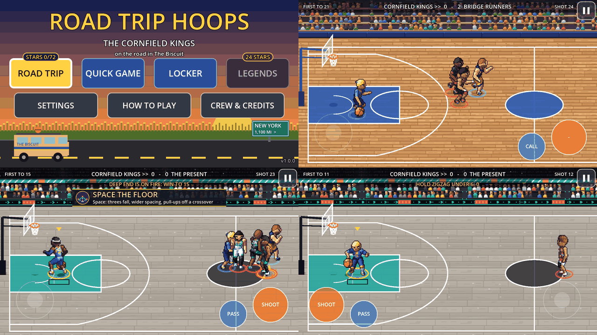

# P11-30: final Phase 11 QA (Legends Chapter 3, "the Present")

- **Build tested:** `43b2cbc` (branch `ccr-f5c087b2-3ojk5f`: all of Phase 11 through P11-29's docs, P11-26's perk
  sizes 0.025 / 0.010 / 0.010 / 0.005 / 1.15 / 0.80, P11-B2's teal `#0a7385` (`legends_data.gd` line 158) and P11-B1's
  portraits). Godot 4.3 stable, Linux. Version 1.0.0.
- **Isolation:** every native run used its own copy of the project (from `git archive`, `config/name="Hoops QA P1130
  <run>"`) and its own fresh `XDG_DATA_HOME`. The only runs that shared files were the pairs that must share them
  (`--triptest-data` + `--load`; `--trip-stop-after chicago` + `--trip-resume` + the trip-crew `--legends-test`). At most
  2 Godot processes ran at once (a 2-slot queue). The web build came from a separate clean copy with the real name. I
  changed nothing in `scripts/`. All copies and data folders were deleted at the end.
- **Import:** `godot --headless --import` exit 0, no script errors or warnings.
- **Runs:** 289 Godot runs plus the web export, and 4 Playwright sessions. Every run reached its end line and exited 0.
  No script errors anywhere. The only `ERROR` lines are the xvfb runs' audio driver (ALSA, `ERR_CANT_OPEN`, no sound
  card in the box). The only warnings are the ones the self tests plant on purpose.
- **Harness note:** my first queue had a bug: every run shared one project copy and data folder. I stopped it, deleted
  everything it wrote and ran it all again with correct isolation. Every number below comes from the clean rerun.
  (The first plain `--anim-test`, run alone before the bug mattered, is the one reported.)

**Verdict: release-ready.** Every test mode passes. All three chapters play through on every level. The Present's six
challenges and the finale play to the end on BIG STAGE with SPACE THE FLOOR and `legends_present` music. Every Present
signature move and every Present perk fired at least once. Quick Game stats are where Phase 10 left them. The P11-36
side question is answered: **no BLUE/RED lean** (BLUE 48.5%, SE 3.5, 200 games). The web build loads by touch, reaches
the title and plays a Quick Game with no console errors. No new bugs.

*Row 1: the web build (Chromium, touch, real frame timing) on the title (STARS 0/72, LEGENDS dark with its 24 STARS
tab), and a Quick Game 12 s in. Row 2 (xvfb): Deep End's fire challenge on BIG STAGE with the SPACE THE FLOOR banner
under the goal line, and Zigzag's hold challenge in the left-handed layout.*

## 1. Trip tests (`--trip-test --target 3`)

| Run | Result | Games | Screens | Record | Star checks | Draft / legends | Replay (other level) | Errors |
|---|---|---|---|---|---|---|---|---|
| `--difficulty easy` | TRIP END, complete | 37 | 142 | 24-12 | 24/24 paid, every game >= 1, total 26 | `ht_boss` | memphis:1 at HARD, won, trip unchanged | 0 |
| `--difficulty normal` | TRIP END | 52 | 178 | 24-27 | 24/24 paid, >= 2 | `ht_boss` | memphis:1 at HARD, won, unchanged | 0 |
| `--difficulty hard` | TRIP END | 57 | 181 | 24-32 | 24/24 paid, 3 each, total 72 | `ht_boss` | memphis:1 at EASY, lost, unchanged | 0 |
| `--difficulty legend --stars 72` | TRIP END | 48 | 163 | 24-23 | 24/24 paid, 3 each, total 72 | `ht_boss` (4 slots) | memphis:1 at EASY, won, unchanged | 0 |
| `--legends-unlock-all --stars 12` (normal) | TRIP END | 39 | 145 | 24-14 | 24/24 paid, >= 2 | `lg_deep_end` from the PRESENT row (1 slot); a game started `ud_deuce` (you) + Deep End + `ht_boss` | memphis:1 at HARD, lost | 0 |
| extra: `--legends-unlock-all --stars 24 --difficulty hard` | TRIP END | | | 24-17 | ok | `lg_deep_end` (Present row), then `lg_rooftop` (Fathers row); Deep End refused while Rooftop starts ("ONLY ONE LEGEND CAN START. Bench ROOFTOP first."); legend + boss start Present | | 0 |
| normal `--trip-stop-after chicago` | TRIP STOP, saved at memphis game 1, map | | | 6-3 | ok | | | 0 |
| `--trip-resume` (new process, same name and data) | TRIP END | | | 24-11 | ok | `ht_boss` | | 0 |

Every run from a fresh title visited the LOCKER and back. The `--stars 12` run has one star slot, so it can draft only
one legend: the one-legend rule needs two slots. I added the `--stars 24` run to check it, and it passes ("TRIP legend
eras at the end | rows offered grand, fathers, present | drafted present, fathers | one legend tried fathers, present
| legend + boss present | ok"). These are CPU vs CPU games to 3, so the records are noise.

## 2. Self tests

| Test | Result |
|---|---|
| `--viewtest` | VIEWTEST OK |
| `--twisttest` | TWISTTEST OK |
| `--anim-test` (alone) | ANIM OK, exit 0 (164 s). 369 sheets and recolors, 135 `lg_*`, 0 empty frames, 0 without points. `format.json` extras: hook (6 sheets), fadeaway (1), stepback (1), eurostep (1); "listed X, loaded X" for 30 hook, 5 fadeaway, 5 stepback (`lg_deep_end` + recolors), 5 eurostep (`lg_zigzag` + recolors) |
| `--anim-test --anim-fake-v2` | ANIM OK, exit 0 (the planted broken sheets fail as they should) |
| `--startest` / `--cosmetictest` / `--ratingtest` | STARTEST OK / COSMETICTEST OK / RATINGTEST OK |
| `--triptest-data`, then `--load` | TRIPDATA OK, then TRIPDATA OK across the restart (a Present game's best crew holds `lg_eyes_closed` and avoids `lg_deep_end`) |
| `--legendtest` | LEGENDTEST OK: legends 18, 3 of 4 chapters built, max tokens 63; save OK; progress OK; era teams grandfathers, fathers, present OK |
| `--titletest` (plain and `--stars 0`) | TITLE TEST DONE; LEGENDS locked with the 24 STARS tab and its line; `settings.cfg put back as it was: true` |
| `--titletest --legends-unlock-all --stars 48` | TITLE TEST DONE; YOUR TEAM list ends grandfathers, fathers, present; COURT has OLD GYM / NIGHT PARK / BIG STAGE with their twist lines; settings put back |
| `--backtest` | BACKTEST OK, with the Chapter 3 steps: the Present opens at 48 stars, `lg:lg_deep_end` pauses (tree paused), QUIT lands on chapter `present` |

## 3. `--legends-test --target 3` (three chapters)

| Run | Crew | Level | Games | Screens | Tokens (grand / fathers / present) | Gates |
|---|---|---|---|---|---|---|
| `--stars 24` | Kings | normal (the view's) | 20 | 49 | 14 / 14 / - | Fathers met by tokens (14); Present "stars 24, tokens 28 -> not met, timeline locked, ok" (as designed) |
| `--stars 48` | Kings | normal | 30 | 72 | 14 / 14 / 14 | Present met by stars; next "not built, timeline later, ok" |
| `--stars 48 --difficulty easy` | Kings | easy | 30 | 72 | 9 / 9 / 9 | Present met by stars |
| `--stars 24 --difficulty easy` | Kings | easy | 10 | 26 | 9 / - / - | Fathers "tokens 9 -> not met" (as designed) |
| `--stars 24 --difficulty normal` | Kings | normal | 20 | 49 | 14 / 14 / - | as `--stars 24` |
| `--stars 24 --difficulty hard` | Kings | hard | 30 | 72 | 21 / 21 / 21 | Present met by tokens (42) |
| `--stars 72 --difficulty legend` | Kings | legend | 30 | 72 | 21 / 21 / 21 | met by stars and tokens |
| `--stars 24 --legends-chapter present` | Kings | normal | 10 | 26 | present only | gate forced open for the run |
| `--stars 48 --legends-test-three` (still a flag) | Kings | normal | 30 | 63 | 14 / 14 / 14 | ok; it swaps the built Present for the stand-in `lg_zz_present_*` rows |
| `--stars 48 --legends-force-loss 2,9` | Kings | normal | 36 | 78 | 14 / 14 / 14 | 6 forced losses (2 per chapter), 12 retries |
| after `--trip-stop-after chicago` + `--trip-resume` | trip | hard | 30 | 72 | 21 / 21 / 21 | "trip save unchanged" after every game and in every chapter |

Each run ended in LEGENDS END, exit 0. In every chapter of every run the goal tests ran (first hold try broken, first
stop try won with no stops, no tokens, both retried). The best tokens were kept after the replay at another level. HALL
was ok, and each chapter closed with its finale. 63/63 tokens on Hard and LEGEND.

## 4. One `--challenge` per Present legend and `fin:present` (`--autoplay --expected-roster`, real targets)

Every game printed `LEGENDS MATCH ... | twist era_present | look era_present | music legends_present`, and the stats
count `music_legends_present` 1.

| Challenge | Hard (1 game each) | Extra games, Normal |
|---|---|---|
| Deep End (fire, to 15) | met 16-14 (he scored 3, cooled after 2 misses) | |
| Toolbox (comeback from 0-1, to 15) | failed 8-15 | |
| Stretch (race to 11 before 10) | failed 9-10 ("STRETCH'S CREW GOT 10") | |
| Switch (score 5 on him, to 11) | failed 3-11 ("you 1 of 3 pts (min 5)") | |
| Skylight (2 stops, to 15) | failed 13-15 (1/2) | met 15-7 (4/2); failed 11-15 (4/2, lost); failed 15-7 ("ONLY 0 OF 2 STOPS ON SKYLIGHT": a win, but the goal not met) |
| Zigzag (hold under 6, to 11) | failed 6-11 | met 11-9, met 11-10, failed 8-11 |
| Finale (to 21) | met 22-16 | |

One game a cell is not a balance measure (P11-23 has the large samples). The goal here is to show that every game ends,
that each goal type is judged, and that the reasons read right. They do. Game lengths: to 11, 3:54-6:32; to 15,
4:28-5:34; the finale 7:38.

**Signature moves** (SIGNATURE lines in these 13 games): step-back (Deep End, `anim_stepback` frames played), coast
(Toolbox), pop (Stretch), steal and run (Switch), lob magnet (Skylight, 2 of the 4 Skylight games: "lob thrown to him
13.5 ft from the rim", "goes up for the lob 9.1 ft"), Euro-step (Zigzag, `anim_eurostep` played; once in the Hard
Toolbox game, once in Zigzag's first Normal game). All six fired. Lob magnet and Euro-step are rare (P11-23 measured
0.33 and 0.80 a game), and that matches.

## 5. `--humantest` and the six Present perks

**`--humantest`, 2 runs:** Hard 21-18 (6:03, 57 shots, 0 fouls), Normal 21-16 (6:54, 60 shots, 3 fouls, FT 2/2).
Timed steals 12/14 and 10/13. Blocks timed 2/3 and 1/4. Countdown presses ignored 3/3 both times. The box-out assist
fired 18 and 24 times. No errors. This matches Phase 10 (21-15, 21-19; 46 and 62 shots).

**`--humantest --perk <id>`** (all three BLUE players): each run printed `PERK TEST BLUE i <id>` for 0, 1 and 2 with the
new text, and the perk's own `PERK` line:

| Perk | Value | PERK lines / count | Example line |
|---|---|---|---|
| off_dribble | `pullup_bonus` 0.025 | 3 / `perk_off_dribble_t0` 5 | "jumper from 22.2 ft, odds 0.42 (+0.03) made" |
| extra_pass | `assist_shot_bonus` 0.010 | 3 / 10 | "DEUCE's dunk from 3.0 ft, odds 0.92 (+0.010) made" |
| catch_shoot | `catch_shot_bonus` 0.010 | 2 / 3 | "jumper from 10.3 ft, odds 0.47 (+0.01) made" |
| contest | `guard_contest_bonus` 0.005 | 3 / 15 | "KNOX's jumper from 16.8 ft, odds 0.45 (-0.005) missed" |
| board_work | `rebound_reach_mult` 1.15 | 3 / 6 | "rebound reached at 1.82 ft (reach 1.92 ft, x1.15)" |
| side_step | `layup_block_mult` 0.80 | **0 in 5 `--humantest` runs**; 1 in 4 `--autoplay --perk side_step` | "TANK ... layup past DASH's block try (chance 0.33, x0.80)" |

`side_step` only logs when the perk turns away a block that would have landed (a roll between 0.8x and 1x the chance).
P11-26 measured about once in 14 games per pupil, so with three pupils one line in 9 games is what to expect. It works.
(Note: the `off_dribble` line prints `+0.03` for 0.025 because of `%.2f`. That is only a test log, not a bug.)

## 6. `--autoplay` games to 21 (Hard vs Hard, gym, Kings vs Bridge Runners) against Phase 10

| Stat | Now, 20 games | Now, 200 games (the side check, both orders) | Phase 10 (P10-30), 20 games | CLAUDE.md band | |
|---|---|---|---|---|---|
| Shots | 60.5 (39-74) | 61.2 (40-91) | 60.3 (43-81) | about 55-90 | pass |
| FG % | 52.4% (43-64) | 52.7% (36-75) | 56.0% (42-64) | about 50% | pass |
| Game length | 9:45 (6:12-12:51) | 9:44 (6:39-14:07); 35 of 200 over 11:00, 4 under 7:00 | 9:54 (7:36-12:18) | 7-11 min | pass |
| Loser's points | 15.5 (10-20) | 16.6 (7-20) | 16.8 (11-20) | usually 12-20 | pass |
| Fouls | 2.0 (0-5) | 2.1 (0-8) | 2.1 (0-6) | about 1-5 | pass |
| Out of bounds | 1.1 (0-3) | 1.1 (0-4) | 1.2 (0-4) | 1-2 | pass |
| Side switches | 1 in every game | 1 in every game | 1 in every game | one | pass |
| Offensive rebounds | 21.4% of 566 misses | 24.8% of 5,729 | 25.8% of 532 | about 25% | pass |
| Putbacks | 2.9 (0-6) | 2.9 (0-10) | 3.1 (1-5) | | |
| Interceptions | 3.0 (0-7) | 2.9 (0-9) | 2.8 (0-7) | few | pass |
| Shot-clock violations | 0 | 0 | 0 | few | pass |
| Free throws | 24/33 | 195/274 | 21/28 | | |
| Threes (jumpers) | 11.1 | 12.8 | | | |
| BLUE wins | 14 of 20 | 97 of 200 (48.5%) | 10 of 20 | about even | pass |
| Unfinished, stuck, script errors | 0 | 0 | 0 | 0 | pass |

In the 20 games, FG% (52.4) and OREB (21.4%) read lower than Phase 10's 20 games. The 200 games put both back at 52.7%
and 24.8%, so that was the small sample. Phase 11 changed nothing in Quick Game play with twist none, and the numbers
agree. Game length runs to the top of the band (17.5% of games over 11:00). That is the same share as Phase 10 (4 of 20).

**Era teams on their era courts** (one game each, `--legends-unlock-all --unlock-all`): Grandfathers vs Kings on OLD
GYM 15-21 (11:35, OLD SCHOOL), Fathers vs Runners on NIGHT PARK 17-21 (8:34, ISO BALL), Runners vs Present on BIG STAGE
18-21 (6:21, SPACE THE FLOOR). Each one ends normally with its twist line. P11-36 has the balance (760 games).

## 7. P11-36 watch item: Quick Game BLUE / RED side (Kings vs Runners, 100 games each order)

| Order | Games | BLUE wins | Kings wins |
|---|---|---|---|
| `--quick-teams cornfield_kings,bridge_runners` (Kings BLUE) | 100 | 48 (48.0%, SE 5.0) | 48 |
| `--quick-teams bridge_runners,cornfield_kings` (Runners BLUE) | 100 | 49 (49.0%, SE 5.0) | 51 |
| Both | 200 | **97 (48.5%, SE 3.5)** | **99 (49.5%, SE 3.5)** |

**No side lean and no team lean:** both are within half an SE of 50%. P11-36's 21/60 for BLUE (35%) was chance. One
real difference by side: the RED crew plays its crew style and BLUE doesn't. With the Runners as BLUE (not their inside
style) the game has 14.1 threes against 11.4 the other way round, but the win shares don't move.

## 8. Screenshots (xvfb, 1280x720) and the web build

- `--shots` (gym), `--shots --challenge deep_end --expected-roster`, `--shots --left-handed --challenge zigzag`. The HUD
  is readable and nothing is off screen. The goal lines ("DEEP END IS ON FIRE: WIN TO 15", "HOLD ZIGZAG UNDER 6: 0") are
  centred under the top bar. The SPACE THE FLOOR banner sits under the goal line and fits. Deep End's fire ring shows.
  The BIG STAGE floor (ash planks, teal key) reads well. In the left-handed layout SHOOT and PASS sit bottom left and the
  joystick on the right. The buttons don't cover either rim. PASS.
- **Web build:** `tools/build_web.sh` (build only, never `--publish`) in a clean copy: exit 0, `build/web` 82 MB. I
  served it on 127.0.0.1 and opened it in Playwright Chromium (SwiftShader), 1280x720, `hasTouch`, with taps as CDP
  touch events and real frame timing. Fresh storage: the title with STARS 0/72, LEGENDS dark with "24 STARS", v1.0.0.
  A tap on LEGENDS shows "LEGENDS OPEN AT 24 STARS. YOU HAVE 0: WIN TRIP GAMES!". QUICK GAME opens the level panel
  (Kings vs Runners, COURT: GYM). NORMAL starts the countdown and the game, and touch play works (CALL, the A button).
  The pause button opens the panel (score, stats, RESUME / RESTART / QUIT). Console: 0 errors, 0 page errors. The only
  line was Chromium's AudioContext autoplay note before the first tap. PASS.
- **Not done on the web this time:** the board row's longer path (a Chapter 3 unlock, the Hall, a Present draft, a
  mentor and an era team in Quick Game by touch). The native runs cover each of these through the same screens:
  `--legends-test` (unlocks, finales, Hall), `--trip-test --legends-unlock-all` (the Present draft row, the one-legend
  rule), `--titletest --legends-unlock-all` (era teams and courts) and `--backtest` (a Present challenge's pause and
  QUIT). P11-28 shot the screens.

## 9. Bugs

**No new bugs.** P11-B1 (portraits) and P11-B2 (teal `#0a7385`) are in the build. The `--legendtest` name, perk and
portrait checks pass (I did not shoot the tags or portraits again; P11-28 did). P10-B7's fix (`twist_fx.gd` line 265)
is in the build. In the web game I saw no stuck banner strip, but a gym Quick Game has no banner, so this run did not
recheck it.

Notes for the lead (not bugs):
- `--legends-test-three` still works, but now that the Present is built it replaces the real chapter with the stand-in
  rows. It could be retired or documented as "stand-in only".
- The `off_dribble` PERK log rounds 0.025 to `+0.03` (`%.2f`). It's only a test log, so changing it is optional.

## 10. Checks

| Check | Result |
|---|---|
| Import clean | PASS |
| `--trip-test` on every level, with legends (Present row, two eras, one-legend rule), stop and resume | PASS (8 runs) |
| `--legends-test` on every level, three chapters, `--legends-chapter present`, `--legends-test-three`, forced losses, a trip crew | PASS (11 runs) |
| All self tests (viewtest, twisttest, anim-test alone + fake-v2, startest, cosmetictest, ratingtest, triptest-data + load, legendtest, titletest x3, backtest) | PASS |
| One `--challenge` per Present legend plus `fin:present`; music `legends_present` | PASS (13 games end, every goal type judged, all six signatures fire) |
| `--humantest` x2; `--perk` x6 Present perks, each with its PERK line | PASS (side_step needed the extra autoplay games, see 5) |
| 20 `--autoplay` against Phase 10 | PASS (no change measurable on 200 games) |
| P11-36 side check, 200 games | PASS: BLUE 48.5% (SE 3.5) |
| Screenshots | PASS |
| Web build: build only, Playwright touch, title, Quick Game, pause | PASS, 0 console errors |
| Bugs that block the release | none |

## Proposed targets

No change for Quick Game. The CLAUDE.md bands still fit, measured on 200 games: 61 shots at 53%, 9:44, loser 16.6,
2.1 fouls, 1.1 out of bounds, OREB 24.8%, 2.9 interceptions, 0 shot-clock violations.
