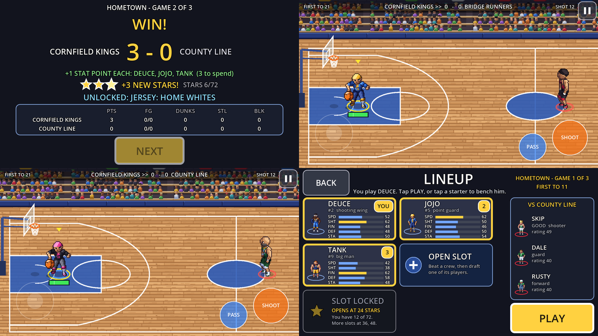

# P8-29: final Phase 8 QA

- **Build tested:** `b19f466` (branch `ccr-f5c087b2-3ojk5f`: all Phase 8 work, the P8-B1..B8 fixes, the P8-25 ramp
  with STAGE_AVG 40/46/52/58/63/68/73/78 and LEGEND_BONUS 12). Godot 4.3 stable, Linux. Version 1.0.0.
- **Isolation:** every native run used a copy of the project with `config/name="Hoops QA P829"` and its own
  `XDG_DATA_HOME` per run (a fresh one for each trip level), so no `user://` file was shared. The owner's files and
  other agents' folders were not touched. At most 2 Godot processes ran at once. The xvfb screenshot runs used a
  private mount namespace (`unshare -m`, a private folder bound over `/tmp`). The web build came from a second clean
  copy with the real project name.
- **Import:** `godot --headless --import` gave exit 0, with no script errors or warnings.

**Verdict: release-ready.** Every check passed. I found no new bug, so there is no P8-B9. P7-B1 did not reproduce in
20 of 20 tries on the web build. The one failure I did see was caused by the test harness (section 5), so I suggest
closing P7-B1.

*Top left: the result screen with the UNLOCKED line (item 4). Top right: `--wear jersey_2` against the Bridge
Runners, switched back to the normal look. Bottom left: the same jersey against County Line, worn. Bottom right: the
web build's lineup with an open slot (touch).*

## 1. Trip tests (`--trip-test --target 3`)

| Run | Result | Games | Screens | Record | Star checks | Draft | Replay | Locker | Errors |
|---|---|---|---|---|---|---|---|---|---|
| `--difficulty easy` | TRIP END, complete | 45 | 158 | 24-20 | 45/45 ok; end: 24/24 paid, every game 1 star, total 24 | `ht_boss` (slot from 12 stars) | memphis:1 lost, trip unchanged | ok | 0 |
| `--difficulty normal` | TRIP END, complete | 46 | 162 | 24-21 | 46/46 ok; 24/24 paid, every game 2 stars, total 48 | `ht_boss` after Chicago | memphis:1 lost, unchanged | ok | 0 |
| `--difficulty hard` | TRIP END, complete | 54 | 176 | 24-29 | 54/54 ok; 24/24 paid, every game 3 stars, total 72 | `ht_boss` | memphis:1 won (+0 stars), unchanged | ok | 0 |
| `--difficulty legend --stars 72` | TRIP END, complete | 61 | 192 | 24-36 | 61/61 ok; 24/24 paid, 3 stars each, total 72 (real 72) | `ht_boss` (4 slots open) | memphis:1 won, unchanged | ok | 0 |
| `--trip-stop-after chicago` | TRIP STOP, saved at memphis game 1, map | 9 | | 6-3 | 9/9 ok | | | ok | 0 |
| `--trip-resume` (new process, same data dir) | TRIP END, complete | 39 | 129 | 24-23 | 39/39 ok; 24/24 paid, total 48 | `ht_boss` (the 12 stars from the stop run opened the slot) | memphis:1 won, unchanged | not visited (no fresh title, as designed) | 0 |

Every run exited 0. No run printed a script error, `ERROR` or `WARNING`. The level got harder in order: LEGEND lost
the most games (36), then Hard (29), Normal (21) and Easy (20). These are CPU vs CPU games to 3, so they are noisy and
are not a balance measure; P8-25 measured the ramp.

## 2. Self tests

| Test | Result |
|---|---|
| `--backtest` | BACKTEST OK, exit 0 |
| `--titletest` | TITLE TEST DONE (locker, settings, crew, quick game left-handed); `settings.cfg put back as it was: true`, exit 0 |
| `--startest` | STARTEST OK, exit 0 |
| `--cosmetictest` | COSMETICTEST OK, exit 0 |
| `--anim-test` | SHEETS OK, ANIM OK, exit 0. The only warnings are the self-test's planted bad sheets (wrong size, RGBA, gray RGB) |
| `--twisttest` | TWISTTEST OK, exit 0 |
| `--triptest-data` | TRIPDATA OK (the bosses fixture moves 2 of 3 bosses to the bench, as P8-14b says), exit 0. The only warning is the planted save version 99 |
| `--triptest-data --load` (second process) | TRIPDATA OK, exit 0 |
| `--ratingtest` | RATINGTEST OK, exit 0 |

**P8-26 (save migration):** `docs/qa/phase8-saves.md` (build `723810a`) passed on every 1.0.0 fixture. Crew points,
paid games and stars were credited once, bosses were repaired, CONTINUE landed on the right screen, the 1.0.0 build
loaded version 2 saves, and the owner's 1.0.0 `settings.cfg` kept its unlocks. P8-B1 and P8-B2 came from it and are
fixed in this build. `--triptest-data` above still covers the fixture loads.

## 3. `--autoplay` games to 21 (12 games, Hard vs Hard, gym, Kings vs Bridge Runners)

| # | Final (BLUE-RED) | Length | Shots | FG % | Fouls | OOB | Side switches |
|---|---|---|---|---|---|---|---|
| 1 | 21-19 | 9:39 | 64 | 56% | 3 | 0 | 1 |
| 2 | 19-21 | 11:43 | 81 | 44% | 2 | 2 | 1 |
| 3 | 21-16 | 7:17 | 58 | 52% | 1 | 0 | 1 |
| 4 | 19-21 | 12:04 | 85 | 46% | 4 | 1 | 1 |
| 5 | 17-21 | 9:46 | 71 | 46% | 4 | 3 | 1 |
| 6 | 17-21 | 7:19 | 57 | 54% | 3 | 1 | 1 |
| 7 | 18-21 | 11:48 | 69 | 55% | 3 | 1 | 1 |
| 8 | 21-15 | 8:04 | 61 | 54% | 1 | 0 | 1 |
| 9 | 21-17 | 8:53 | 63 | 54% | 2 | 1 | 1 |
| 10 | 21-19 | 8:30 | 61 | 57% | 2 | 1 | 1 |
| 11 | 22-19 | 8:22 | 65 | 55% | 5 | 1 | 1 |
| 12 | 16-21 | 10:19 | 77 | 42% | 6 | 1 | 1 |

| Stat | Mean (range) | Reference (CLAUDE.md, P7-T1) | |
|---|---|---|---|
| Shots | 67.7 (57-85) | about 50-80 | pass (2 of 12 above 80; P8-26 saw 57-84) |
| FG % | 51.4% (42-57) | about 50% | pass |
| Game length | 9:30 (7:17-12:04) | 7-11 min | pass (3 of 12 a little over 11; P8-25 saw 5.7-12.4) |
| Loser's points | 17.6 (15-19) | usually 12-20 | pass |
| Fouls per game | 3.0 (1-6) | about 1-5 | pass (one game had 6) |
| Out of bounds | 1.0 (0-3) | 1-2 | pass |
| Side switches | 1 in every game | one | pass |
| Interceptions | 3.4 (1-6) | few (Phase 6: 3.9) | pass |
| Shot-clock violations | 0 | few | pass |
| Free throws | 14/18 in all | | |
| BLUE wins | 6 of 12 | about even, by chance | pass |
| Unfinished games, stuck ball or players, script errors | 0 | 0 | pass |

These are the same as P8-26's 5 games (69.6 shots, 10:05) and the P8-25 batches, so there was no simulation change
after P7-T1. I'm not suggesting any tuning.

**`--humantest` (5 runs):** 21-14, 17-21, 21-17, 21-19, 21-19. Lengths 7:05-8:18, 63-78 shots, 1-5 fouls. Every
code path ran: timed steals 9-12 of 13-16, blocks, crossovers, free throws, and countdown presses ignored 3/3. There
were no errors.

## 4. The UNLOCKED line on the result screen

The run was `--trip-test --target 3 --screens --difficulty hard --trip-stop-after hometown` under xvfb, with a fresh
data dir (new `settings_test.cfg`, no `--stars`). It logged `STARS hometown:1 0 -> 3 (total 3)`, then `hometown:2 0
-> 3 (total 6)`, then TRIP STOP.

- Game 1's result screen (`hoops_screen_10_result.png`) shows WIN 3-0, the stat point line, 3 stars, "+3 NEW STARS!"
  and STARS 3/72, with no unlock line. This is correct.
- Game 2's result screen (`hoops_screen_14_result.png`, top left above) shows the same rows, then STARS 6/72 and a new
  line in light blue: **"UNLOCKED: JERSEY: HOME WHITES"**. The line is centred and readable. It fits between the stars
  and the stats box, and NEXT stays on screen at 1280x720. **PASS.**

## 5. Web build (Chromium, Playwright, touch)

Setup: `tools/build_web.sh` (no `--publish`) built `build/web` (69 MB) with no errors. It was served by
`python3 -m http.server` on 127.0.0.1 and opened in Playwright 1.63 Chromium headless shell (SwiftShader) with a
1280x720 viewport and `hasTouch`. Every tap was a real touch sent through CDP `Input.dispatchTouchEvent`.

**By touch, on the normal page (no flags):**
- The title showed with STARS 0/72, LOCKER and v1.0.0 bottom-right. QUICK GAME opened the level panel, and NORMAL
  started the game. The HUD, the pause button, the joystick ring and PASS/SHOOT were all inside the view.
- **P7-B1 recheck:** Quick Game NORMAL, then pause, QUIT, a gap, and QUIT again. A script did this 20 times with gaps
  of 0.4 to 1.5 s and checked for the title each time. **20/20 went back to the title.**
  - My first manual try failed, with a screenshot taken between the two taps. I timed the harness: a screenshot
    takes 1.74 s under SwiftShader, and each CDP tap about 0.66 s. So the second tap came about 2.8 s after the first.
    That is past `CONFIRM_TIME` (2.5 s), so the second tap armed QUIT? again, and the screen showed "QUIT?". This is
    how the game is meant to work, and it matches P7-40: there, the failures happened with screenshots between the
    taps, and 8/8 passed without them.
  - **Suggestion:** close P7-B1 as a harness effect. If the owner still sees it on the tablet, a longer
    `CONFIRM_TIME` in `scripts/pause.gd` (e.g. 3.5) is the safe change.

**By touch, on a trip (page args `-- --target 3 --stars 12 --no-countdown`, test settings in the browser's storage):**
- I reached ROAD TRIP, "No trip saved yet", NEW TRIP, EASY, the story (SKIP), the map (HOMETOWN, Game 1 of 3, level
  EASY, every pin at 0/9) and GO.
- The lineup showed DEUCE YOU, JOJO and TANK, an **OPEN SLOT** card ("Beat a crew, then draft one of its players")
  and SLOT LOCKED "OPENS AT 24 STARS, You have 12 of 72". Then PLAY.
- I played six games to 3 by touch with a scripted joystick and buttons: drive, shoot, pass, steal. All of them were
  lost (0-3, 0-3, 2-3, 1-3, 1-3, 1-4). Each loss gave the LOSS result screen ("No penalty: run it back!"), then
  RETRY, then Jojo's first-loss story, then the lineup. Switching sides, game point and the FINAL banner all showed.
- **I did not win a game by touch.** My scripted player is not good enough, even on Easy. So I could not do the won
  game, the points screen, the draft or the replay by touch.

**The same build and runtime, driven by the trip test** (page args `-- --trip-test --target 3 --stars 12
--trip-stop-after denver`):
- It ended with **TRIP STOP after denver**: saved at Seattle game 1, on the map, after 24 games (15-8 plus one
  replay).
- On the way it covered won games, their result screens, the per-win **points** screen, the **draft** (OPEN SLOT
  tapped, `ht_boss` drafted, back on the lineup, in the save) and the **map replay** (memphis:1 from the picker; the
  trip did not move; saved ok). All 24 star and paid checks were ok.
- The console showed no script error and no page error. The only lines were Godot's usual exit messages at the forced
  quit (ObjectDB leaked, resources in use, PagedAllocator), which P7-40 also saw. The other sessions logged nothing
  but the GL "GPU stall due to ReadPixels" note.

## 6. Jersey clash (P8-B7 auto-switch)

| Run | JERSEY CLASH lines | Look |
|---|---|---|
| `--autoplay --target 3 --stars 72 --wear jersey_2` (AFTER HOURS vs Bridge Runners) | 3: `JERSEY CLASH BRIDGE RUNNERS: ud_jojo_j2 -> ud_jojo`, the same for `ud_tank` and `ud_deuce` | `--shots`: the Kings play in their normal blue and gold (top right above), easy to tell from the black and red Runners. PASS |
| `--autoplay --target 3 --stars 72 --wear jersey_1` (HOME WHITES) | none | `--shots`: Deuce in white and blue against the Runners' black and red; clear. PASS |
| `--shots --stars 72 --wear jersey_2 --quick-teams cornfield_kings,county_line` | none | AFTER HOURS worn (black, pink trim, pink hair) against County Line's green; clear. PASS |

Both games to 3 ended normally (1-3), with no errors.

## 7. Screenshots looked at

- `--shots` gym, frames 240/900/1800, for the plain look and each jersey. The HUD is readable, nothing is off screen,
  and the joystick and buttons don't cover the action.
- The `--screens` trip to Hometown: title, locker, story, map, lineup, both result screens, points (twice), recruit.
- Web: title, Quick Game panel, game, pause panel (QUIT and QUIT?), trip menu, level pick, story, map, lineup with an
  open slot, the game at the barn court, and the loss result.

## Pass / fail

| Check | Result |
|---|---|
| Import, no script errors | PASS |
| Trip test: easy, normal, hard, legend (`--stars 72`) | PASS (TRIP END ×4) |
| Trip stop after Chicago, then resume | PASS (TRIP STOP, then TRIP END) |
| backtest, titletest, startest, cosmetictest, anim-test, twisttest, triptest-data (+ `--load`), ratingtest | PASS |
| 12 `--autoplay` games, stats as P7-T1 | PASS |
| 5 `--humantest` runs | PASS |
| UNLOCKED line on the result screen | PASS |
| Web build: loads, touch play, pause, trip screens; no console errors | PASS |
| Web: won game, points, draft, replay | PASS through the trip-test driver on the web runtime; by touch I only got as far as losses and RETRY |
| P7-B1 on the web build | PASS (20/20); the one miss was a harness timing effect |
| Jersey clash: lines with jersey_2, none with jersey_1, looks | PASS |

## Bugs

None found in this pass (no P8-B9).

One note, not a bug: with `--target N` the map info box and the lineup header still show the trip's real target
("to 11", "FIRST TO 11"), while the HUD says FIRST TO 3. This only happens with the test flag, and players never see
it.

## Suggested tuning

None. The game stats match the P7-T1 reference.
