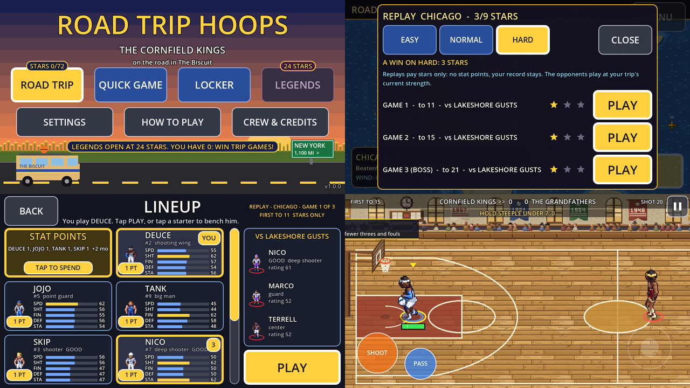

# P9-34: final Phase 9 QA

- **Build tested:** `f90d0a6` (branch `ccr-f5c087b2-3ojk5f`: all of Phase 9, the replay level picker, the smaller
  perks, the tuned challenges (P9-26), and the late rebounding change: box-outs, `CONTEST_TIGHT_MULT` 0.68,
  `LAYUP_OPEN_PCT` 0.79, the human box-out assist). Godot 4.3 stable, Linux. Version 1.0.0.
- **Isolation:** every native run used its own copy of the project (from `git archive`, `config/name="Hoops QA P934
  <run>"`) and its own fresh `XDG_DATA_HOME`. The pairs that must share files (`--triptest-data` + `--load`, the
  `--trip-stop-after` + `--trip-resume` pair, a trip stop + `--legends-test` on its crew) shared one name and one data
  folder, and nothing else did. At most 2 Godot processes ran at once (a 2-slot queue). The xvfb runs used a private
  mount namespace (`unshare -m`, a private folder bound over `/tmp`, copies saved outside). The web build came from a
  separate clean copy with the real project name. Nothing in `scripts/` or `docs/BOARD.md` was changed.
- **Import:** `godot --headless --import` exit 0, no script errors or warnings.
- **Runs:** 323 Godot runs, plus 13 Playwright sessions on the web build. Every run reached its end line. The only
  non-zero exit was a harness problem (an OOM kill when two `--anim-test` runs overlapped, see 2).

**Verdict: release-ready.** Every test mode passed. I found two Low bugs (P9-B8, P9-B9), and neither blocks the
release. One balance cell moved a lot after the make-rate change (Velvet on Normal, section 4); the pooled challenge
shares are still inside the P9-26 bands.

*Web build, touch, 1280x720. Top left: a fresh start, LEGENDS dark with the "24 STARS" tab and the tap line. Top
right: the map's replay picker with HARD picked ("A WIN ON HARD: 3 STARS"). Bottom left: the replay's lineup. The
STAT POINTS line is clipped ("+2 mo", P9-B8), and NICO is on both teams (P9-B9). Bottom right: Steeple's challenge
in the OLD GYM with the goal line under the top bar.*

## 1. Trip tests (`--trip-test --target 3`)

| Run | Result | Games | Screens | Record | Star checks | Draft | Replay (other level) | Errors |
|---|---|---|---|---|---|---|---|---|
| `--difficulty easy` | TRIP END, complete | 39 | 146 | 24-14 | 39/39 ok; end 24/24 paid, every game >= 1, total 26 | `ht_boss` | memphis:1 at HARD, won (+2), trip unchanged | 0 |
| `--difficulty normal` | TRIP END | 54 | 179 | 24-29 | 54/54 ok; 24/24 paid, >= 2, total 49 | `ht_boss` | memphis:1 at HARD, won (+1), unchanged | 0 |
| `--difficulty hard` | TRIP END | 50 | 170 | 24-25 | 50/50 ok; 24/24 paid, 3 each, total 72 | `ht_boss` | memphis:1 at EASY, lost, unchanged | 0 |
| `--difficulty legend --stars 72` | TRIP END | 87 | 246 | 24-62 | 87/87 ok; 24/24 paid, 3 each, total 72 | `ht_boss` (4 slots) | memphis:1 at EASY, won (+0), unchanged | 0 |
| easy `--legends-unlock-all --stars 24` | TRIP END | 29 | 127 | 24-4 | 29/29 ok; 24/24 paid | `lg_steeple`, `lg_gate` (LEGENDS row, hint has the rule) | memphis:1 at HARD, won | 0 |
| normal, same flags | TRIP END | 45 | 162 | 24-20 | 45/45 ok | the same | memphis:1 at HARD, lost | 0 |
| hard, same flags | TRIP END | 53 | 177 | 24-28 | 53/53 ok | the same | memphis:1 at EASY, lost | 0 |
| legend `--legends-unlock-all --stars 72` | TRIP END | 66 | 209 | 24-41 | 66/66 ok; total 72 | the same | memphis:1 at EASY, won | 0 |
| normal `--trip-stop-after chicago` | TRIP STOP, saved at memphis game 1, map | 12 | | 6-6 | 12/12 ok | | | 0 |
| `--trip-resume` (new process, same name and data) | TRIP END | 41 | 131 | 24-28 overall | 41/41 ok; 24/24 paid, total 49 | `ht_boss` | memphis:1 at HARD, won, unchanged | 0 |

Every run exited 0 and visited the LOCKER and back (the resume run doesn't visit it, because it never sees a fresh
title, as designed). In all 4 legend runs: the second legend starter was refused ("ONLY ONE LEGEND CAN START. Bench
STEEPLE first."), a recruit screen signed `ht_boss`, a game started as legend + boss (`ud_deuce` you, `lg_steeple`,
`ht_boss`), and the end line says "one legend ok | legend + boss ok". The driver never made a legend YOU. "total 24
(real 48)" in the `--stars 24` runs is expected: `--stars` overrides the total shown.

These are CPU vs CPU games to 3, so the records are noise. Still, the losses rise with the level, from Easy to LEGEND.
LEGEND lost 62 (RED won 72% of the games). That matches P8-25's "LEGEND +12 about 71% RED", so it is not new.

## 2. Self tests

| Test | Result |
|---|---|
| `--legendtest` | LEGENDTEST OK (data: 6 legends, 1 of 4 chapters built, max tokens 21; save OK; progress OK), exit 0 |
| `--backtest` | BACKTEST OK, exit 0. Includes the Legends steps (chapter view -> timeline -> title, the Hall to its back, the picker closes) |
| `--titletest` (`--stars 0`) | TITLE TEST DONE; LEGENDS locked with the tab "24 STARS" and the line "LEGENDS OPEN AT 24 STARS. YOU HAVE 0: WIN TRIP GAMES!"; no HALL on CREW; `settings.cfg put back as it was: true` |
| `--titletest --stars 24 --legends-unlock-all` | TITLE TEST DONE; LEGENDS open, legends screen and BACK; CREW shows HALL OF LEGENDS, Hall and BACK to CREW |
| `--startest` | STARTEST OK (the ladder 6 .. 72 as in CLAUDE.md) |
| `--cosmetictest` | COSMETICTEST OK |
| `--anim-test` | SHEETS OK, ANIM OK, exit 0. 262 v2 sheets. `format.json` extras: hook on 6 sheets. All 30 `lg_*` sheets and recolors report "extras listed hook, loaded hook (9 pages in all)", 1240 frames, 0 empty, 0 without points. The extra-page checks (x0 page, hand and ball points, recolors, two x pages) are ok. The only warnings come from the self-test's planted bad sheets |
| `--anim-test --anim-fake-v2` | ANIM OK, exit 0, on the rerun. The first try was OOM-killed (exit 137) while the plain `--anim-test` ran next to it. That is my harness: two anim tests at once is too much memory for this container. Rerun alone: fine |
| `--twisttest` | TWISTTEST OK (`era_grand`: `long_shot_mult` 0.8, `speed_mult` 0.94, `inside_mult` 1.08, `foul_mult` 0.6) |
| `--triptest-data` + `--triptest-data --load` | TRIPDATA OK, then "round trip across a restart: same state", TRIPDATA OK. My first pair reported FAILED because my harness gave the two processes different `config/name`s, so the second one had no save. With one shared name it passed. The only warning is the planted save version 99 |
| `--ratingtest` | RATINGTEST OK (open layup at 50 = 0.790, the new `LAYUP_OPEN_PCT`) |
| `--viewtest` | VIEWTEST OK |

## 3. `--legends-test --stars 24 --target 3`

| Run | Crew | Level | Games | Screens | Tokens | Checks |
|---|---|---|---|---|---|---|
| fresh data | Kings ("NO TRIP: THE KINGS PLAY") | easy | 10 | 26 | 9/21 (7 x 1, Steeple replayed at HARD: 3) | LEGENDS END; unlocked 6/6, chapter done, 9 scenes, hall ok, trip save unchanged |
| fresh data | Kings | normal | 10 | 26 | 14/21 (replay at EASY keeps 2) | the same |
| fresh data | Kings | hard | 10 | 26 | 21/21 | the same |
| fresh data, `--stars 72` | Kings | legend | 10 | 26 | 21/21 | the same |
| after `--trip-test --trip-stop-after chicago` (normal) | trip (`ht_g1`, `ud_jojo`, `ud_deuce`) | normal | 10 | 26 | 14/21 | LEGENDS END; trip save (1499 bytes) unchanged after every game |
| after the same on hard | trip (the same three) | hard | 10 | 26 | 21/21 | LEGENDS END; trip save (1674 bytes) unchanged |
| `--legends-force-loss 2,5` | Kings | normal (the chapter view's) | 12 | 28 | 14/21 | LEGENDS END; 2 forced losses, 4 retries |

In every run, the first "hold" try broke its goal ("STEEPLE SCORED 7", 0 tokens) and the first "stop" try was won
with no stops ("ONLY 0 OF 2 STOPS ON BOXCAR", 0 tokens). Both were then retried and won. There were 0 errors or
warnings. A note on the log only: on a replay that keeps the best, `LEGENDS RESULT` prints e.g. `tokens 3 -> 3 (+1)`.
The `+1` is the replay's own tokens, not a gain. Nothing on screen shows it that way.

## 4. Challenge balance after the make-rate change (re-measure of P9-26)

The setup was P9-26's: `--autoplay --challenge <id> --difficulty <level> --expected-roster` (BLUE `ud_deuce
70/71/72/72/71, ud_jojo 71/71/73/71/72, ud_tank 69/68/68/70/69`, the same crew P9-26 used), each game to its real
target. There were 200 games: 10 per cell, and 20 in the cells that moved. Every game printed its `CHALLENGE` line.
There were 0 errors and 0 shot-clock violations. OREB was 23.7% of 3,564 misses.

| Challenge | Normal now | Normal P9-26 | Hard now | Hard P9-26 |
|---|---|---|---|---|
| Steeple (hold < 7, to 15) | **90%** (18/20) | 70 | 60% (12/20) | 70 |
| Gate (race 11 before 10) | 60% (6/10) | 65 | 35% (7/20) | 40 |
| Set Shot (fire, to 15) | 80% (8/10) | 80 | 50% (5/10) | 65 |
| Boxcar (2 stops, to 15) | 60% (6/10) | 55 | **20%** (4/20) | 40 |
| Velvet (hold < 6, to 11) | **45%** (9/20) | **90** | 60% (12/20) | 40 |
| Quarterback (from 0-2, to 15) | 50% (5/10) | 60 | 40% (4/10) | 25 |
| **Pooled, 6 challenges** | **65%** (52/80) | 70 | **44%** (44/100) | 47 |
| Finale (to 21) | 50% (5/10) | 55 | 60% (6/10) | 45 |

The SE is about 11 points on a 20-game cell and 15-16 on a 10-game cell. P9-26's cells were 20 games each.

- **The pooled shares did not move.** Normal is 65% (band 55-75) and Hard is 44% (band 35-50). Normal is still
  above Hard. PASS.
- **Flag: Velvet on Normal fell from 90% to 45%** (18/20 to 9/20, about 3 SE apart). Of the 11 failures, 5 were the
  goal ("VELVET SCORED 6") and 6 were plain losses at 11 (5-11 .. 10-11). On Hard the same challenge went up from 40%
  to 60%. So Velvet is now harder on Normal than on Hard. Over both levels it is 21/40 (52%), down from 26/40 (65%).
- **Watch: Boxcar on Hard is 20%** (4/20, was 40%; about 1.4 SE). It is the lowest cell, under P9-26's lowest (25%).
  Most failures are close losses (13-15, 14-15); 3 of them broke on stops.
- Steeple on Normal rose to 90% (+20, about 1.7 SE). The other cells are within 1 to 1.5 SE.
- The signature moves all fired across the 200 games: hook 398 (`anim_hook` 369, 32 escapes), finger roll 355,
  outlet 262 (130 caught), long dunk 185, deep set 128, keep block 80 (59 tips, 21 keeps).

**Suggestion:** change nothing yet. The pooled bands hold, and the Velvet cells point in opposite directions on
Normal and Hard. That looks more like noise on a short game to 11 than a shift in one direction. If the lead wants
Velvet Normal back near 70%, measure 40 games per level first. The lever is Velvet's `limit` in `legends_data.gd`
(6 -> 7 helps both levels). For Boxcar Hard, a 40-game batch would show whether 20% is real before anything is
touched.

**The era (OLD SCHOOL) in Quick Game crews** (`--autoplay --twist era_grand`, 40 games): RED (Bridge Runners,
"inside") won 27/40 (68%). P9-17 measured 47-59% (`docs/qa/phase9-era.md`). That is about 1.5-2 SE higher. The
make-rate nudge raised open layups to 0.79, and with `inside_mult` 1.08 that helps an inside crew more. Era Quick
Games aren't offered (`era_grand` is never in the COURT list), so this only matters through the challenges above. I'm
noting it as a watch item, not a bug.

## 5. `--autoplay` games to 21 (40 games, Hard vs Hard, gym, Kings vs Bridge Runners) and the era

| Stat | Plain, mean (range), 40 games | `--twist era_grand`, 40 games | Typical game (CLAUDE.md) | |
|---|---|---|---|---|
| Shots | 61.5 (42-81) | 61.8 (40-80) | about 55-90 | pass (8 of 40 plain games under 55, all of them fast high-FG% games) |
| FG % | 53.9% (43-71) | 56.5% (43-76) | about 50% | pass |
| Game length | 9:49 (6:33-12:41) | 10:29 (6:55-13:36) | 7-11 min | pass (11 of 40 plain games over 11:00; the commit measured 9:39 on 100) |
| Loser's points | 16.2 (6-20) | 16.9 (10-20) | usually 12-20 | pass (one 6-21) |
| Fouls | 2.2 (0-6) | 1.6 (0-4) | about 1-5 | pass (era `foul_mult` 0.6) |
| Out of bounds | 1.4 (0-4) | 1.1 (0-4) | 1-2 | pass |
| Side switches | 1 in every game | 1 in every game | one | pass |
| **Offensive rebounds (REBOUNDS line)** | **26.6% of 1,145 misses** (per game 6-53%) | 24.8% of 1,087 | about 25% | pass |
| Putbacks | 3.1 (0-8) | 3.4 (0-9) | (was 8.0 before the change) | |
| Interceptions | 3.5 (0-7) | 3.8 (1-10) | few | pass |
| Shot-clock violations | 0 | 0 | few | pass |
| Free throws | 44/59 | 32/44 | | |
| BLUE wins | 16 of 40 (40%) | 13 of 40 (33%) | about even, by chance (40-game batches swing to 65/35) | pass / see section 4 |
| Unfinished games, stuck ball or players, script errors | 0 | 0 | 0 | pass |

The first 22 plain games alone gave OREB 29.0%, and all 40 gave 26.6%. With ~1,100 misses, the SE is about 1.3
points, so this is on target. The commit measured 26% on 100 games.

**`--humantest` (3 runs, Hard):** 21-12, 13-21, 17-21, 6:05-7:42, 49-61 shots, 1-6 fouls. Timed steals 9/13, 7/9 and
12/15. Blocks timed 2/3, 1/3 and 2/6. Countdown presses were ignored 3/3 each time. **The box-out assist fired**: 12,
18 and 15 rebounds ("BOXOUT ASSIST ... drifts to box out ..." lines). RED misses, hands off: defensive rebounds 2/4,
4/4 and 2/5. Steering: 12/14, 3/5 and 5/8. There were no errors. A `--humantest --challenge steeple --pauseshot` under
xvfb ended 15-10, met ("hold: lg_steeple 4 pts").

## 6. Screenshots (xvfb, 1280x720)

`--shots` (gym), `--shots --court era_grand --twist era_grand`, `--shots --left-handed --court gold_hall`, and
`--humantest --pauseshot --challenge steeple`. The HUD is readable and nothing is off screen. The OLD SCHOOL banner
("Old school: slower, more inside, fewer threes and fouls", the laced-ball icon) sits under the top bar. In a
challenge, the goal line "HOLD STEEPLE UNDER 7: 0" is centred under the score and the banner sits below it (P9-B4
holds). The pause panel shows the OLD SCHOOL line. In the left-handed layout, the joystick is on the right and
SHOOT/PASS are bottom left. The buttons don't cover the play area near the rims. PASS.

## 7. Web build (Chromium, Playwright, touch)

`tools/build_web.sh` (no `--publish`) built `build/web` (74 MB) in a clean copy, exit 0. I served it on 127.0.0.1
and opened it in Playwright 1.63 Chromium headless shell (SwiftShader), 1280x720, `hasTouch`. Every tap was a CDP
`Input.dispatchTouchEvent`.

- **Fresh start (empty storage):** the title shows STARS 0/72 and v1.0.0. **LEGENDS is dark with the "24 STARS"
  tab**, and a tap shows "LEGENDS OPEN AT 24 STARS. YOU HAVE 0: WIN TRIP GAMES!" while the screen stays on the title.
  PASS.
- **Quick Game:** QUICK GAME opens the level panel (EASY / NORMAL / HARD, YOUR TEAM, OPPONENT, COURT, MUSIC, TITLE).
  I picked NORMAL and played about 30 s by touch: joystick drives, SHOOT, PASS / SWITCH and STEAL. The pause panel
  showed SHOTS 0/2 vs 0/1. Pause, then QUIT, then QUIT again 0.5 s later went back to the title. PASS.
- **Map replay picker:** to reach it by touch, I seeded the browser's `user://` (IndexedDB) with the committed
  fixtures `trip_v2_mid.json` as `trip.json` and `settings_v2_24.cfg` as `settings.cfg`, then reloaded. Then:
  - The title showed STARS 24/72 and LEGENDS open. ROAD TRIP showed "MEMPHIS, GAME 2 - 7-1 - NORMAL", and CONTINUE
    opened the map.
  - Tapping the CHICAGO pin opened "REPLAY CHICAGO - 3/9 STARS" on NORMAL ("A WIN ON NORMAL: 2 STARS"). I tapped HARD
    ("A WIN ON HARD: 3 STARS") and PLAY on game 1, which logged `TRIP REPLAY chicago:1 start | stage 3 | level hard
    (trip normal)`.
  - The lineup said "REPLAY - CHICAGO - GAME 1 OF 3, FIRST TO 11 STARS ONLY". PLAY started the game (rooftop, WIND,
    left-handed layout from the settings). In the game, pause, QUIT, QUIT went back to the map ("MAP replay marker
    dropped"), with the trip still at Memphis game 2, 7-1, NORMAL. The picker opened on NORMAL again. PASS.
- **Legends on the web (same seeded data):**
  - LEGENDS opened the timeline (TOKENS 0/21, Chapter 1 PLAY, Chapters 2-4 COMING LATER with their gates). PLAY
    played the intro scene, and SKIP went to the chapter view (6 locked plaques, the finale locked, YOUR CREW = the
    trip's starters DEUCE / MAYOR / NICO, NORMAL).
  - PLAY started Steeple's challenge in the OLD GYM ("HOLD STEEPLE UNDER 7: 0"). Pause, QUIT, QUIT landed on the
    chapter view. PASS.
- **Console:** no script errors and no page errors in any of the 13 sessions. The only lines were Godot's start
  lines, the AudioContext autoplay note, the GL "GPU stall due to ReadPixels" note (from the screenshots) and our own
  test prints.
- I didn't win a game by touch, so I didn't see an unlock, the Hall detail or a legend draft on the web. The native
  `--legends-test` and `--trip-test --legends-unlock-all` runs cover those through the same screens.

## 8. Bugs

**P9-B8 (Low, cosmetic; since P8-18, `scripts/lineup.gd`): the STAT POINTS card clips its "+n more".**
- Steps: load `docs/qa/fixtures/trip_v2_mid.json` as the trip (6 roster players, each with 1 point), CONTINUE, then
  any lineup (GO, or a replay from the map).
- Expected: "DEUCE 1, JOJO 1, TANK 1, SKIP 1  +2 more" fits in the card.
- Actual: the line runs past the card and is cut at "+2 mo" (picture above, bottom left). This happens whenever 5 or
  more players hold points, which is common once SKIP is used on the points screen.
- Fix idea (not a tuning constant): `POINTS_NAMES_MAX` 4 -> 3, or wrap the line or shrink its font in
  `_draw_points()`.

**P9-B9 (Low; since P8-17, `scripts/trip.gd` `match_for()`): in a replay, your own recruit or drafted player can be
on the other team too.**
- Steps: recruit or draft a city's player (e.g. `chi_g1` NICO), then replay a game of that city where he is in the
  opponents' lineup (Chicago game 1). With the fixture: CONTINUE, tap the CHICAGO pin, PLAY game 1.
- Expected: he plays for you only. The opposing crew fields someone else, as a Legends game does for a drafted legend
  ("<legend> SITS: <player> PLAYS").
- Actual: the lineup shows NICO as your starter and NICO in "VS LAKESHORE GUSTS", so the same player is on both
  teams. `crew_for_game()` never checks the roster. Every `--trip-test` replay has it too, with the player on the
  bench, e.g. `CORNFIELD KINGS [...] vs RIVERSIDE SOUL ["mem_g1", ...]` while `mem_g1` is on the roster. On a
  normal trip it can't happen, because a city's games are over before you sign anyone from it.
- Fix idea: in a replay, swap a rostered opponent for another player of that crew (the trip test could then check
  that no id is on both sides).

**Harness notes (not game bugs):** the first `--triptest-data --load` FAILED, and the first `--anim-fake-v2` run was
OOM-killed. Both came from my setup (see 2), and both passed when rerun.

## 9. Checks

| Check | Result |
|---|---|
| Import clean | PASS |
| `--trip-test` on every level, with and without legends; stop and resume | PASS (10 runs, all complete) |
| `--legends-test` (Kings and a trip crew, normal and hard; also easy, LEGEND and forced losses) | PASS (7 runs) |
| All self tests (legendtest, backtest, titletest x2, startest, cosmetictest, anim-test incl. the hook pages, twisttest, triptest-data + load, ratingtest, viewtest) | PASS |
| 40 `--autoplay` vs the typical game, incl. REBOUNDS about 25% | PASS (26.6%) |
| 40 `--autoplay --twist era_grand` | PASS on the bands; RED 68% is a watch item |
| 3 `--humantest`, box-out assist exercised | PASS |
| Challenges re-measured on Normal and Hard (expected crew) | PASS pooled (65% / 44%); flag Velvet Normal 90 -> 45, watch Boxcar Hard 20 |
| Screenshots | PASS |
| Web build (touch): title, LEGENDS locked, Quick Game, pause and QUIT, the replay picker with a level, a challenge and its QUIT | PASS, no console errors |
| Bugs that block the release | none (P9-B8, P9-B9 are Low) |
